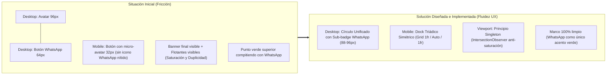

# UX Design Specification: Unificación de Widget Flotante, Mobile Sticky Bar y Principio Singleton de la Mascota

> **Documento de Diseño UX para Traspaso Técnico (Hand-off)**  
> **Autor:** Sally (UX Designer)  
> **Proyecto:** ASOEXI B2B Web App (`asoexi-app`)  
> **Fecha:** 11 de Octubre, 2026  
> **Estado:** Implementado y Validado  
> **Ubicación:** `_bmad-output/planning-artifacts/ux-designs/ux-mascota-floating-dock-2026-10-11/ux-design-spec.md`

---

## 1. Resumen Ejecutivo y Diagnóstico

### 1.1 El Problema Detectado
En la versión inicial existían tres fricciones de experiencia de usuario:
1. **"Torre Flotante" en Desktop:** Dos círculos apilados de forma independiente (avatar de 96px y botón verde de WhatsApp de 64px) que generaban duda de interacción (*"¿hago clic en la cara o en el botón?"*) y fragmentación visual.
2. **Micro-avatar y Desbalance en Mobile:** La barra fija móvil incrustaba un video-avatar de 32px dentro del botón verde. A este tamaño el personaje perdía definición, consumía recursos y desplazaba el isotipo oficial de WhatsApp. Además, la diferencia de longitud de texto entre botones provocaba que el personaje se desplazara fuera del centro.
3. **Saturación y Duplicidad (Personaje No-Singleton):** Al navegar hacia el banner comercial inferior (*"Solicita tu Cotización..."*), el usuario veía simultáneamente a la mascota en el banner y en el widget flotante, junto a múltiples botones verdes en el mismo campo visual.
4. **Punto verde residual en el marco:** La presencia de un punto verde superior ("en línea") competía con el sub-badge verde de WhatsApp y causaba ruido visual y halos de foco táctil en dispositivos móviles.



---

## 2. Decisiones de Diseño de Interacción (Interaction Design)

### Decisión 1: Widget Flotante Unificado en Desktop (Círculo con Sub-Badge)

* **Concepto:** Una sola unidad interactiva. El personaje saludando es el protagonista visual y el canal de WhatsApp queda identificado inequívocamente mediante un sub-badge.
* **Geometría y Dimensiones:**
  * **Contenedor Principal:** Círculo de `88px × 88px` (o `96px × 96px`) con sombra profunda (`shadow-2xl`), borde blanco pulido (`border-2 border-white ring-2 ring-slate-300/80`).
  * **Contenido Central:** Video loop de la mascota saludando (`/animated/greeting-float.mp4`).
  * **Sub-Badge de WhatsApp:** Círculo de `36px × 36px` a `40px × 40px` anclado a la esquina inferior derecha (`bottom-0 right-0`). Fondo verde oficial WhatsApp (`#25D366`), icono oficial de WhatsApp en blanco nítido (`20px × 20px`), con borde separador blanco de `2px` para garantizar contraste contra el avatar.
  * **Sin punto verde redundante:** Se eliminó el punto verde de "en línea" en el marco superior para evitar ruido cromático y mantener el foco en la acción de contacto.
* **Micro-interacciones y Estados:**
  * **Hover:** Escala sutil del conjunto a `1.05` con elevación de sombra.
  * **Tooltip Flotante (Desktop):** Al posar el cursor, despliega un globo contextual a la izquierda:  
    `"¿Cotización urgente? Habla con el Asesor Técnico"`.
  * **Click / Tap:** Abre el canal directo de WhatsApp institucional.
  * **Accesibilidad:** `aria-label="Abrir WhatsApp para cotizar con el Asesor Técnico ASOEXI (SLA ≤ 5 min)"`.

---

### Decisión 2: Mobile Sticky Bar con Arquitectura Triádica y Centrado Matemático

* **Concepto:** Resolver la tensión entre mantener la simpatía del personaje y maximizar la legibilidad de los botones de acción mediante un diseño en 3 bloques simétricos (Dock Industrial).
* **Solución de Balance (CSS Grid):**
  * Para evitar que la diferencia de caracteres entre *"Llamar"* y *"Cotizar WhatsApp"* desplace la mascota fuera del centro, el contenedor utiliza `grid grid-cols-[1fr_auto_1fr]` con `min-w-0` en ambas columnas laterales.
  * Esto garantiza que la columna izquierda y la derecha tengan **exactamente el mismo ancho en píxeles**, bloqueando a la mascota en el **50% horizontal exacto** de la pantalla.
* **Estructura Visual:**
  ```text
  +-------------------------------------------------------------------------+
  |  [ (tel) Llamar ]   |       ( ^_^ )       |   [ (WA) Cotizar WhatsApp ]  |
  |  Línea Corporativa  |   Asesor Técnico    |   Respuesta Inmediata        |
  +-------------------------------------------------------------------------+
  ```
* **Especificaciones de los 3 Componentes:**
  1. **Botón Izquierdo (Llamada Directa):**
     * Color: Fondo `slate-900` (`bg-secondary`).
     * Icono: Teléfono industrial en color amarillo ámbar (`text-amber-industrial`).
     * Texto: `"Llamar"`.
     * Altura táctil: Mínimo `48px` conformante con WCAG AAA.
  2. **Pivote Central (Avatar de la Mascota Elevado):**
     * Tamaño: Círculo de `52px × 52px` con margen superior negativo (`-mt-6`) sobresaliendo del dock.
     * Borde: Borde blanco de `2px`, anillo sutil `ring-slate-200/90` y sombra `shadow-md`.
     * Sin aro residual táctil: Uso de `focus-visible` para evitar bordes verdes persistentes tras el toque táctil en móviles.
     * Rol interactivo: Dispara `open-contact-modal` para abrir el selector completo [`ContactChannelModal`](file:///home/fernando/Fernando/Own/asoexi-app/src/islands/ContactChannelModal.tsx).
  3. **Botón Derecho (Cotizar por WhatsApp):**
     * Color: Verde WhatsApp oficial (`#25D366` / `bg-whatsapp hover:bg-whatsapp-hover`).
     * Icono: **Isotipo oficial de WhatsApp SVG** en blanco (18px-20px).
     * Texto: `"Cotizar WhatsApp"`.
     * Altura táctil: Mínimo `48px`.

---

### Decisión 3: Principio del Personaje Singleton y Control de Saturación

* **Regla de Negocio UX:** En ninguna vista ni nivel de scroll deben coexistir dos instancias activas de la mascota o dos botones verdes compitiendo por la misma acción comercial.
* **Mecanismo de Detección:**
  * `IntersectionObserver` vinculado al banner comercial de cotización (`#cotizar`).
* **Comportamiento en Desktop:**
  * **Al entrar al Banner:** El widget flotante unificado transiciona a oculto (`opacity-0 translate-y-8 pointer-events-none transition-all duration-300`).
  * **Al salir del Banner:** Reaparece suavemente (`opacity-100 translate-y-0`).
* **Comportamiento en Mobile:**
  * **Al entrar al Banner:** La barra fija móvil se desliza hacia abajo (`translate-y-full opacity-0 pointer-events-none transition-all duration-300`), dejando la pantalla completamente despejada para el banner de cotización que ya cuenta con su propia mascota grande y botones dedicados.
  * **Al salir del Banner:** La barra fija regresa a su posición visible (`translate-y-0 opacity-100`).

---

## 3. Matriz de Componentes Técnicos Implementados

| Componente | Archivo | Estado |
| :--- | :--- | :--- |
| **Widget Flotante Desktop** | [`src/components/common/FloatingWhatsAppButton.astro`](file:///home/fernando/Fernando/Own/asoexi-app/src/components/common/FloatingWhatsAppButton.astro) | **Implementado**: Avatar único 88-96px con sub-badge WhatsApp 36-40px y tooltip contextual en hover. Sin punto verde superior. |
| **Barra Fija Móvil** | [`src/islands/MobileStickyBar.tsx`](file:///home/fernando/Fernando/Own/asoexi-app/src/islands/MobileStickyBar.tsx) | **Implementado**: Grid triádico simétrico (`1fr_auto_1fr`), avatar central 52px con elevación -mt-6, botón WhatsApp con icono oficial. Sin aro verde tras toque. |
| **Controlador Singleton Observer** | [`src/layouts/BaseLayout.astro`](file:///home/fernando/Fernando/Own/asoexi-app/src/layouts/BaseLayout.astro) | **Implementado**: `setupSingletonMascotObserver()` con `IntersectionObserver` activo en `#cotizar`. |
| **Banner Comercial** | [`src/pages/index.astro`](file:///home/fernando/Fernando/Own/asoexi-app/src/pages/index.astro) | **Validado**: Ancla `#cotizar` sincronizada con el observer. |

---

## 4. Criterios de Aceptación Verificados (Acceptance Criteria)

- [x] **CA-01 (Desktop):** Un solo elemento flotante en pantalla grande (`md:flex`), combinando avatar circular y sub-badge de WhatsApp. Sin segundo botón apilado.
- [x] **CA-02 (Mobile):** Botón de WhatsApp en la barra móvil muestra el isotipo oficial SVG junto al texto legible "Cotizar WhatsApp".
- [x] **CA-03 (Mobile):** Personaje ubicado en el centro exacto (50%) de la pantalla mediante cuadrícula simétrica, con tamaño táctil accesible (52px) y animación de saludo.
- [x] **CA-04 (Singleton / Anti-saturación):** Al entrar el banner `#cotizar` al viewport, el widget de escritorio y la barra móvil se ocultan suavemente.
- [x] **CA-05 (Accesibilidad & Safe Area):** La barra respeta `env(safe-area-inset-bottom)` y todos los botones cumplen con targets ≥ 48px de altura.
- [x] **CA-06 (Limpieza Visual):** Eliminación de puntos verdes redundantes y halos de foco táctil residuales.
- [x] **CA-07 (Compilación):** `npm run build` pasa con 0 errores y 0 advertencias.

